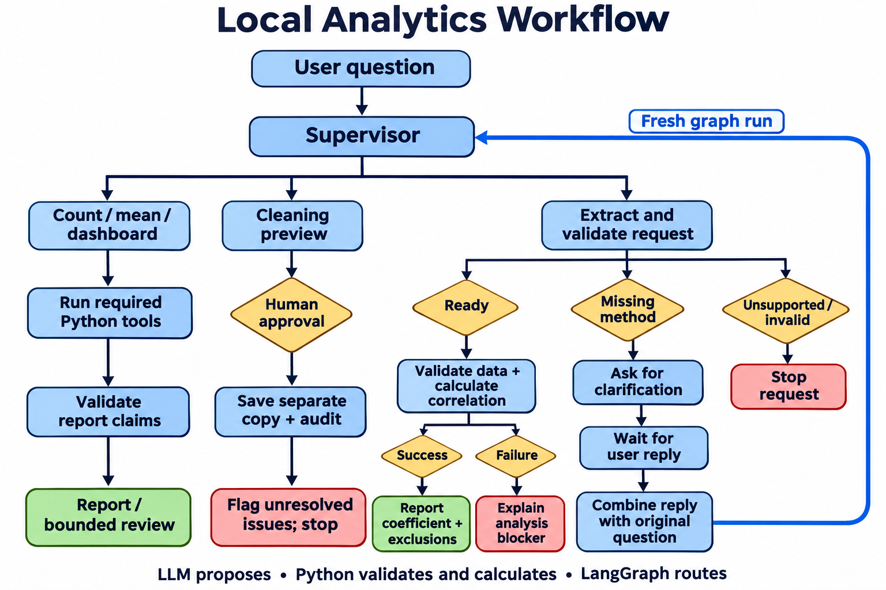
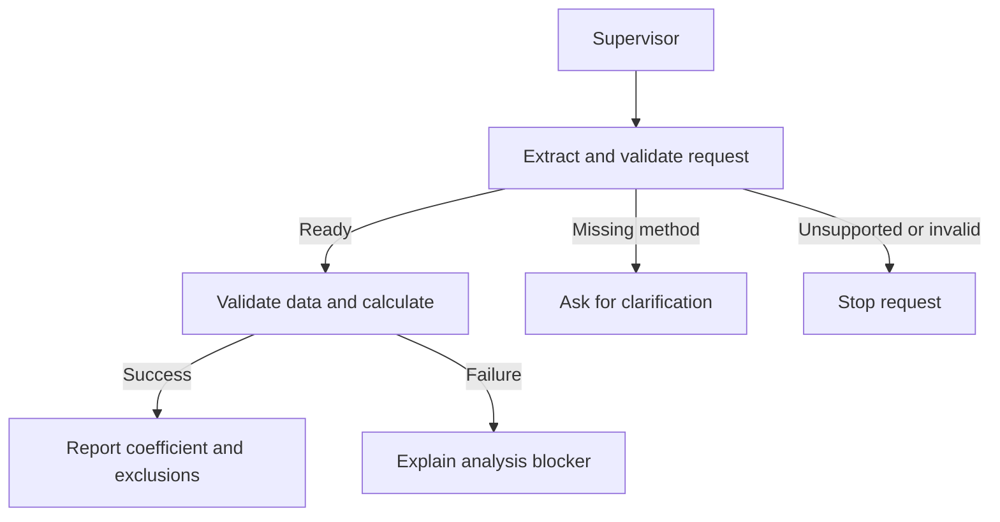

# Local Multi-Agent Analytics System

A Python learning prototype for local data analysis, request validation, human-approved cleaning, and scheduled reporting. It uses a llama.cpp-served model, LangChain tool interfaces, LangGraph workflows, and SciPy calculations. Paid cloud model APIs are not required.

There are two separate entry points:

- **Interactive assistant:** interpret questions, validate requested correlation methods/columns, run supported tools, and preview cleaning with approval.
- **Daily analytics:** inspect a CSV export, apply an explicit copy-cleaning policy, block business metrics on unresolved issues, and save evidence-backed HTML/JSON reports. This scheduled path works without an LLM by default.

This is a tested prototype, not a production service. All committed example data are synthetic.

<p align="center">
  
</p>

## How the project was built

The project began with a simple question: how can a local language model answer questions about data it cannot access directly? We built the calculation functions first, then added model requests, tool execution, workflow routing and validation. The same locally served Qwen3.5-0.8B-Q8_0 model was reused for different roles through different prompts; these roles do not require separate model deployments.

| Stage | What was built | What it taught us |
| --- | --- | --- |
| 1. Local model connection | A Python HTTP client communicating with llama-server | A model response does not mean the model has accessed a dataset. |
| 2. Python tools | Dataset inspection, mean calculation and an allowlisted tool executor | Functions must validate arguments and data independently of the model. |
| 3. Agent-loop experiments | JSON action requests, observations, duplicate-call protection and a decision limit | Correct calculations can still sit inside a failing decision loop. |
| 4. LangChain and native tool calling | `@tool` schemas, `.invoke()`, structured tool requests and matching `ToolMessage` IDs | A tool request is a proposal; Python still executes the function. |
| 5. LangGraph coordination | Supervisor, specialist workers, shared state and conditional edges | Explicit routes control which operations run and when the workflow stops. |
| 6. Review and reliability | Structured report claims, Python checks, bounded revision, request gates and tests | A second model opinion cannot replace enforceable correctness checks. |

### Why both LangChain and LangGraph?

LangChain packages existing Python functions as tools. The `@tool` decorator uses a function's description and type hints to expose its name and input schema. Calling `.invoke()` validates the supplied arguments before calling the underlying function. For example, omitting the required `column` argument is a schema error; passing a text column to a numeric calculation is a separate data-validation error handled by Python.

LangGraph coordinates execution. A **state** stores the question, classification, tool results and final status. A **node** performs one step and returns state updates. A **conditional edge** runs a Python routing function to select the next node. For example, a count request skips mean calculation, while a combined request runs inspection and calculation before reporting. LangGraph could orchestrate ordinary Python functions without LangChain; the tool wrapper is a convenient interface, not a requirement for graph routing.

The interactive cleaning choice comes from a person typing `approve` or `reject`. Python checks that choice and saves the outcome. LangGraph routes the cleaning branch; LangChain does not decide whether a person has approved a change.

### Tool calling versus execution

In the early manual version, the model returned ordinary JSON text such as:

```json
{"tool": "calculate_mean", "arguments": {"column": "order_value_eur"}}
```

The parser converted that text into a dictionary, and an allowlisted executor checked the tool and arguments before running the function. Printing this JSON did not execute a calculation.

The separate `native_tool_call.py` experiment sends the tool schema through LangChain's model interface and reads a structured `tool_calls` response. Python executes the request and returns a `ToolMessage` with the matching call ID. That result is then sent back to the model for an explanation. The experiment explicitly requires the mean tool, so its success demonstrates the message protocol rather than independent tool selection. The main graph uses classification and predefined Python tool workers instead of this native tool-calling loop.

## Walkthrough: a correlation request

For `Calculate Spearman correlation between marketing cost and order value.`, the interactive workflow follows these responsibilities:

| Step | Responsibility |
| --- | --- |
| Supervisor | Propose a task classification using the local model. |
| Request extraction | Extract the operation, method and requested columns from the original question. |
| Python request gate | Check the supported operation, method and column pair. |
| Correlation tool | Validate numeric data, prepare aligned complete pairs and calculate with SciPy. |
| Reporting | Format the successful result and disclose excluded rows. |



With the small interactive fixture, Spearman correlation is approximately **0.40**, using four complete pairs and excluding one row with a missing order value. This is a descriptive association, not evidence of causation. The tools support Pearson, Spearman and Kendall; the workflow does not silently choose a method when none was requested.

For the question `Calculate correlation between marketing cost and order value.`, extraction should leave the method empty and the validator asks which method to use. For `Calculate Pearson correlation between age and salary.`, the extractor should preserve those unsupported column names so Python can reject them. Mapping every request to the available columns would risk answering a different question.

## Failures encountered and safeguards added

| Observed challenge | Change and practical effect |
| --- | --- |
| The model repeatedly requested the same mean calculation | Duplicate-call protection prevented repeated execution, but the model still failed to finish. A narrower classification-driven workflow made supported multi-step tasks explicit. |
| A model reviewer approved an incomplete report and later approved a deliberately incorrect draft | Reporting was changed to structured numerical claims. Python compares required fields and numbers against tool evidence before model review; a model verdict cannot override a numerical mismatch. |
| The supervisor guessed Spearman when no method was named | A separate extraction and validation gate checks the requested details before correlation runs. |
| Unsupported columns were classified as a supported correlation task | The validator checks the column pair, rather than trusting the task label alone. |
| The supervisor invented a `predict` task and raised an exception | Unknown task labels fall back to request validation, where unsupported operations can stop with a clear response. |
| A required marketing-cost field was absent from the data | Data validation blocked calculation and identified the affected rows and column. The synthetic fixture was then completed explicitly. |
| A test tried to overwrite a LangChain tool's `invoke` method | The test replaced the module's tool reference with a mock instead of modifying the Pydantic-based tool instance. |

For count-and-mean reporting, the controlled fault-injection experiment replaced the first draft's facts with **999 orders and a EUR 999 mean**, leaving the actual tool results unchanged. Python detected the mismatch against five orders and a EUR 125 mean, returned correction feedback, and allowed a second draft. The successful run ended with the correct values. The workflow permits at most two report drafts; failed revision ends in a failed-review status. The temporary corruption was a test technique, not intended application behavior.

The original five-row interactive dataset has four recorded order values and one missing value. Its mean is **EUR 125**. This differs from the daily CSV example's **EUR 144 mean order value** because they are separate datasets and the daily example aggregates order lines into distinct orders.

## Data-quality checks and approved cleaning

The richer synthetic order-line fixture contains 12 rows with deliberately introduced problems: an exact duplicate, conflicting records sharing a key, an invalid key, problematic dates, a missing numeric value, numeric text and a non-finite value. It lets us exercise failure paths with known expected outcomes.

Key checks use `(order_id, line_id)`, so multiple different lines in one order are valid. Exact duplicates are distinguished from conflicting records. Date validation accepts explicit supported formats and rejects impossible or ambiguous dates. Numeric validation rejects text, booleans, NaN and infinity. Correlation preparation keeps each x/y pair aligned and records missing-pair exclusions instead of dropping values independently. Constant columns, insufficient pairs and unsupported methods are also checked.

The cleaning proposal makes only two intended changes in this fixture: remove the confirmed duplicate at source row 3, keeping source row 1, and normalize the valid dotted date at source row 6 to ISO format. The candidate has 11 rows. Conflicting records and other unresolved issues remain visible. Repeating the proposal makes no additional changes, and source-row mappings make the changes traceable.

Approval creates a separate copy and records a unique decision ID, UTC timestamp, proposed changes and applied changes. Rejection saves a decision audit without a cleaned dataset. Invalid input creates no saved decision. Storage tests check reloading, independence from the source and prevention of overwriting an existing decision. **Approval authorizes the listed changes; it does not certify that the remaining data are fit for analysis.**

## What the tests demonstrate

A controlled test supplies data or simulated model/tool responses with known expected behavior. For example, a mock can make a tool raise an exception or return NaN so the test can verify that reporting and dashboard generation never run on that failed path. Mocked responses test workflow rules; they do not measure the real model's language understanding.

| Test area | Examples of checks |
| --- | --- |
| Data identity and quality | Compound keys, conflicts, dates, finite numbers and unchanged source data |
| Calculations | Known positive/negative correlations, rank-method differences, ties and missing-pair accounting |
| Request gating | Missing methods, unsupported columns/operations and malformed extraction JSON stop tool execution |
| Workflow execution | Correct nodes run; failed analysis cannot reach successful reporting |
| Cleaning | Only intended edits, repeatability, approval/rejection, independent copies and saved audits |
| Daily reporting | CSV headers, distinct-order metrics, policy controls, failure reports, escaped HTML and baseline selection |

The packaged snapshot passed **104 automated tests: 89 core tests and 15 daily analytics tests**. See `TEST_RESULTS.md` for the verification environment. A test marked `ok` means its assertions held, including tests that expect a rejection. A failed assertion is reported as `FAIL`; an unexpected exception is reported as `ERROR`. The default unittest runner usually continues through the remaining tests and returns an unsuccessful exit status if any fail.

Earlier live runs with the local model provided separate diagnostic evidence: the initial supervisor classified **9/12** questions correctly, extraction passed **8/8** examples, and the gated full workflow eventually passed **4/4** scenarios after fixing the invalid-task fallback. These results measure different parts of the system, use small development sets, and were not rerun during packaging. They do not imply perfect accuracy on new requests.


## Quick start

Use Python 3.12 or newer on macOS or Linux. Development was exercised on macOS Python 3.14 and packaging tests on Linux Python 3.12; this is not a complete platform support matrix. The daily CLI uses POSIX `fcntl` and is not Windows-compatible as supplied. The schedule installer is macOS-only.

From the repository folder:

```bash
python3 -m venv .venv
source .venv/bin/activate
python -m pip install -r requirements.txt
python run_tests.py
```

The runner includes the root tests and `daily_analytics.tests`, and prevents accidental calls to the model during testing. Expected suite size for this snapshot: **104 tests** (89 core + 15 daily analytics).

## Run daily reporting without an LLM

```bash
python -m daily_analytics --init-demo
python -m daily_analytics
```

The first command creates `daily_input/orders.csv` only if it does not already exist. The second prints the generated report location. Open `report.html` in your browser. A run also saves JSON evidence, a node trace, the original CSV snapshot and a separate candidate copy when ingestion succeeds.

The clean example has 6 order lines, 5 distinct orders and EUR 720 in recorded line value. Mean order value is EUR 144 because lines are aggregated to orders first.

Configuration: [`daily_analytics/config.json`](daily_analytics/config.json). Runtime inputs and generated reports are ignored by Git. Supplying the same unchanged export each morning does not create new business observations; it creates new run records for the same data.

### Daily CSV contract

One row represents one order line. Required headers:

```text
order_id,line_id,order_date,quantity,line_value_eur,marketing_cost_eur
```

- `(order_id, line_id)` is the compound key. Different lines in one order are valid.
- Dates accept `YYYY-MM-DD` or `DD.MM.YYYY`. Ambiguous slash dates are rejected.
- Quantity is a positive whole number; numeric fields use a decimal point. Blank numeric cells are missing. The initial business policy is sales-only; refunds/returns need an explicitly adapted policy.
- `line_value_eur` is the line total, not the unit price. It must not be multiplied by quantity again.
- Marketing cost must be allocated per line; do not repeat a whole-order marketing budget on each line.
- Extra columns are retained but do not automatically acquire business checks or analyses.

The supplied automatic policy removes confirmed exact duplicates and normalizes valid dates **in a separate copy**. Conflicting IDs, invalid dates and invalid/missing numeric values remain flagged; business metrics and correlations are blocked when required quality checks fail. Inspect the policy before using real company exports. Original files are not overwritten.

Analysis includes export KPIs, date totals, descriptive Pearson/Spearman/Kendall correlations, median/MAD unusual-value flags, and threshold comparisons with an earlier-day successful export. Snapshot changes are not automatically daily sales growth. Correlation and anomaly flags are not causal explanations or hypothesis-test conclusions. An independent availability monitor and business-specific validation would be needed for a customer deployment.

### Optional daily schedule on macOS

After a successful manual run, with macOS system timezone set to Europe/Berlin:

```bash
python -m daily_analytics.schedule install
python -m daily_analytics.schedule status
```

The per-user LaunchAgent requests a daily start at 08:00. Keep the user session available and the Mac awake for on-time starts. Sleep can delay a calendar job until wake; a powered-off Mac can miss it. This is not a guarantee a report will be delivered at precisely 08:00. Reports are saved locally, not emailed or sent to ChatGPT.

```bash
python -m daily_analytics.schedule remove
```

Installing a copied checkout alongside another scheduled checkout with the same job label requires explicitly removing the previous job first. Copying/publishing this repository does not install or alter any existing Mac schedule. Do not move a working scheduled project without updating its job.

## Run the interactive assistant

Start llama.cpp's server in another Terminal. Replace the executable and model paths with your local paths:

```bash
/path/to/llama-server -m /path/to/model.gguf --host 127.0.0.1 --port 8080 --jinja -c 4096
```

This project was developed using a small quantized local Qwen model. Model/chat-template support affects native tool calling and extraction reliability; another model can behave differently. GGUF files and model licenses are not distributed with this repository.

Then:

```bash
python interactive_agent.py
```

Examples:

- `How many orders are there?`
- `What is the average recorded order value?`
- `Calculate Spearman correlation between marketing cost and order value.`
- `Calculate correlation between marketing cost and order value.` (asks for a method)
- `Create a customer-order dashboard.`
- `Preview cleaning the messy order dataset.`

Commands: `/status`, `/cancel`, `/exit`. A pending method reply such as `Spearman` is added to the original question and sent through a fresh graph run; there is no checkpointed cross-process conversation memory.

**Data separation:** interactive count/mean/correlation tools use the small synthetic `ROWS` in `data_tools.py`. Interactive cleaning uses the synthetic `MESSY_ROWS` fixture. Daily reports read the configured CSV. The interactive assistant does not automatically query the latest daily CSV, choose a saved cleaned dataset, or understand arbitrary company schemas.

## Architecture and reliability

LangGraph maintains request state and conditional routing. LangChain's `@tool` gives functions descriptions, schemas and an invocation interface. Python validates requests and computes numbers through defined tools.

The interactive supervisor and extractor use model-generated JSON. Successful correlation requests proceed only after validation. Missing methods request clarification; unsupported columns and malformed extraction responses stop the path. This does not guarantee that an invented but allowed extraction will be recognized, or that the initial supervisor always chooses the correct branch. Invalid supervisor labels fall back to validation, but malformed supervisor JSON can still raise an error handled by the interactive CLI.

The analysis and dashboard nodes are largely fixed Python workers, not independent reasoning agents. `native_tool_call.py` is a separate native tool-calling demonstration; the main graph invokes tools explicitly after classification/routing.

Mean reporting uses structured claims checked against tool evidence, followed by a bounded model review. Correlation reports are formatted by Python. Interactive cleaning asks for approval, saves a separate copy and an audit, and ends the branch without calculation. That approval is a synchronous Terminal prompt, not a durable LangGraph interrupt. The daily workflow separately uses configured noninteractive copy operations.

Testing combines deterministic unit/integration tests and live model evaluations. Passing tests verifies those scenarios, not all possible requests or production reliability.

## Live evaluations (model server required)

```bash
python evaluate_supervisor.py
python evaluate_extraction.py
python evaluate_full_workflow.py
```

These write local evaluation JSON ignored by Git. The initial supervisor-only diagnostic and the full gated workflow measure different things; do not present their scores as interchangeable. These are small diagnostic sets, some resembling prompt examples, not unbiased general benchmarks. Live results were not rerun during packaging.

## File guide

| Files | Role |
| --- | --- |
| `interactive_agent.py`, `supervisor_graph.py` | Interactive loop and primary graph |
| `model_client.py` | Standard-library HTTP client for local llama-server |
| `data_tools.py`, `langchain_tools.py`, `tool_executor.py` | Calculations, tool wrappers and manual executor |
| `correlation_request.py`, `request_validation.py` | Extraction and request gate |
| `quality_report.py`, `cleaning_proposal.py`, `cleaning_approval.py`, `cleaning_storage.py`, `messy_orders.py` | Data-quality/cleaning workflow and fixture |
| `dashboard_tool.py` | HTML KPI dashboard creation |
| `daily_analytics/` | Scheduled graph, configuration, CSV examples and tests |
| `test_*.py`, `run_tests.py` | Offline tests and combined runner |
| `evaluate_*.py` | Live diagnostic evaluations |
| `agent.py`, `native_tool_call.py`, `demo_reliability.py`, `reliability_graph.py` | Learning examples and shared helpers |

Some main modules import helpers from the learning examples, so they remain at the root. `native_tool_call.py` makes a model request when executed or imported; use it as a standalone example, not a utility module.

## Remaining scope

Hypothesis testing was deliberately postponed. Real Excel/SQL/SAP/ERP connectors, external report delivery, arbitrary tool planning, robust session persistence, stronger source-request matching, customer authentication, retention policy and production monitoring are not implemented. The cleaned dataset still needs its unresolved issues addressed and a selection/query mechanism before downstream interactive use.

No project license is selected in this packaging step. If you intend to grant others reuse rights, choose an appropriate license before advertising the code as licensed open source. Dependency and model licenses remain separate.
