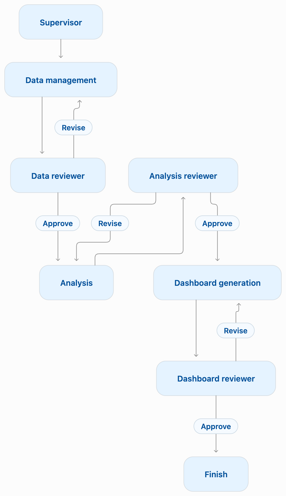

# Local Analytics Agent

A Python learning prototype for local data analysis, request validation, human-approved cleaning, and scheduled reporting. It uses a llama.cpp-served model, LangChain tool interfaces, LangGraph workflows, and SciPy calculations. Paid cloud model APIs are not required.

There are two separate entry points:

- **Interactive assistant:** interpret questions, validate requested correlation methods/columns, run supported tools, and preview cleaning with approval.
- **Daily analytics:** inspect a CSV export, apply an explicit copy-cleaning policy, block business metrics on unresolved issues, and save evidence-backed HTML/JSON reports. This scheduled path works without an LLM by default.

This is a tested prototype, not a production service. All committed example data are synthetic.

<p align="center">
  
</p>

## Quick start

Use Python 3.12 or newer on macOS or Linux. Development was exercised on macOS Python 3.14 and packaging tests on Linux Python 3.12; this is not a complete platform support matrix. The daily CLI uses POSIX `fcntl` and is not Windows-compatible as supplied. The schedule installer is macOS-only.

From the repository folder:

```bash
python3 -m venv .venv
source .venv/bin/activate
python -m pip install -r requirements.txt
python run_tests.py
```

The runner includes the root tests and `daily_analytics.tests`, and prevents accidental calls to the model during testing. Expected suite size for this snapshot: **104 tests** (89 core + 15 daily analytics).

## Run daily reporting without an LLM

```bash
python -m daily_analytics --init-demo
python -m daily_analytics
```

The first command creates `daily_input/orders.csv` only if it does not already exist. The second prints the generated report location. Open `report.html` in your browser. A run also saves JSON evidence, a node trace, the original CSV snapshot and a separate candidate copy when ingestion succeeds.

The clean example has 6 order lines, 5 distinct orders and EUR 720 in recorded line value. Mean order value is EUR 144 because lines are aggregated to orders first.

Configuration: [`daily_analytics/config.json`](daily_analytics/config.json). Runtime inputs and generated reports are ignored by Git. Supplying the same unchanged export each morning does not create new business observations; it creates new run records for the same data.

### Daily CSV contract

One row represents one order line. Required headers:

```text
order_id,line_id,order_date,quantity,line_value_eur,marketing_cost_eur
```

- `(order_id, line_id)` is the compound key. Different lines in one order are valid.
- Dates accept `YYYY-MM-DD` or `DD.MM.YYYY`. Ambiguous slash dates are rejected.
- Quantity is a positive whole number; numeric fields use a decimal point. Blank numeric cells are missing. The initial business policy is sales-only; refunds/returns need an explicitly adapted policy.
- `line_value_eur` is the line total, not the unit price. It must not be multiplied by quantity again.
- Marketing cost must be allocated per line; do not repeat a whole-order marketing budget on each line.
- Extra columns are retained but do not automatically acquire business checks or analyses.

The supplied automatic policy removes confirmed exact duplicates and normalizes valid dates **in a separate copy**. Conflicting IDs, invalid dates and invalid/missing numeric values remain flagged; business metrics and correlations are blocked when required quality checks fail. Inspect the policy before using real company exports. Original files are not overwritten.

Analysis includes export KPIs, date totals, descriptive Pearson/Spearman/Kendall correlations, median/MAD unusual-value flags, and threshold comparisons with an earlier-day successful export. Snapshot changes are not automatically daily sales growth. Correlation and anomaly flags are not causal explanations or hypothesis-test conclusions. An independent availability monitor and business-specific validation would be needed for a customer deployment.

### Optional daily schedule on macOS

After a successful manual run, with macOS system timezone set to Europe/Berlin:

```bash
python -m daily_analytics.schedule install
python -m daily_analytics.schedule status
```

The per-user LaunchAgent requests a daily start at 08:00. Keep the user session available and the Mac awake for on-time starts. Sleep can delay a calendar job until wake; a powered-off Mac can miss it. This is not a guarantee a report will be delivered at precisely 08:00. Reports are saved locally, not emailed or sent to ChatGPT.

```bash
python -m daily_analytics.schedule remove
```

Installing a copied checkout alongside another scheduled checkout with the same job label requires explicitly removing the previous job first. Copying/publishing this repository does not install or alter any existing Mac schedule. Do not move a working scheduled project without updating its job.

## Run the interactive assistant

Start llama.cpp's server in another Terminal. Replace the executable and model paths with your local paths:

```bash
/path/to/llama-server -m /path/to/model.gguf --host 127.0.0.1 --port 8080 --jinja -c 4096
```

This project was developed using a small quantized local Qwen model. Model/chat-template support affects native tool calling and extraction reliability; another model can behave differently. GGUF files and model licenses are not distributed with this repository.

Then:

```bash
python interactive_agent.py
```

Examples:

- `How many orders are there?`
- `What is the average recorded order value?`
- `Calculate Spearman correlation between marketing cost and order value.`
- `Calculate correlation between marketing cost and order value.` (asks for a method)
- `Create a customer-order dashboard.`
- `Preview cleaning the messy order dataset.`

Commands: `/status`, `/cancel`, `/exit`. A pending method reply such as `Spearman` is added to the original question and sent through a fresh graph run; there is no checkpointed cross-process conversation memory.

**Data separation:** interactive count/mean/correlation tools use the small synthetic `ROWS` in `data_tools.py`. Interactive cleaning uses the synthetic `MESSY_ROWS` fixture. Daily reports read the configured CSV. The interactive assistant does not automatically query the latest daily CSV, choose a saved cleaned dataset, or understand arbitrary company schemas.

## Architecture and reliability

LangGraph maintains request state and conditional routing. LangChain's `@tool` gives functions descriptions, schemas and an invocation interface. Python validates requests and computes numbers through defined tools.

The interactive supervisor and extractor use model-generated JSON. Successful correlation requests proceed only after validation. Missing methods request clarification; unsupported columns and malformed extraction responses stop the path. This does not guarantee that an invented but allowed extraction will be recognized, or that the initial supervisor always chooses the correct branch. Invalid supervisor labels fall back to validation, but malformed supervisor JSON can still raise an error handled by the interactive CLI.

The analysis and dashboard nodes are largely fixed Python workers, not independent reasoning agents. `native_tool_call.py` is a separate native tool-calling demonstration; the main graph invokes tools explicitly after classification/routing.

Mean reporting uses structured claims checked against tool evidence, followed by a bounded model review. Correlation reports are formatted by Python. Interactive cleaning asks for approval, saves a separate copy and an audit, and ends the branch without calculation. That approval is a synchronous Terminal prompt, not a durable LangGraph interrupt. The daily workflow separately uses configured noninteractive copy operations.

Testing combines deterministic unit/integration tests and live model evaluations. Passing tests verifies those scenarios, not all possible requests or production reliability.

## Live evaluations (model server required)

```bash
python evaluate_supervisor.py
python evaluate_extraction.py
python evaluate_full_workflow.py
```

These write local evaluation JSON ignored by Git. The initial supervisor-only diagnostic and the full gated workflow measure different things; do not present their scores as interchangeable. These are small diagnostic sets, some resembling prompt examples, not unbiased general benchmarks. Live results were not rerun during packaging.

## File guide

| Files | Role |
| --- | --- |
| `interactive_agent.py`, `supervisor_graph.py` | Interactive loop and primary graph |
| `model_client.py` | Standard-library HTTP client for local llama-server |
| `data_tools.py`, `langchain_tools.py`, `tool_executor.py` | Calculations, tool wrappers and manual executor |
| `correlation_request.py`, `request_validation.py` | Extraction and request gate |
| `quality_report.py`, `cleaning_proposal.py`, `cleaning_approval.py`, `cleaning_storage.py`, `messy_orders.py` | Data-quality/cleaning workflow and fixture |
| `dashboard_tool.py` | HTML KPI dashboard creation |
| `daily_analytics/` | Scheduled graph, configuration, CSV examples and tests |
| `test_*.py`, `run_tests.py` | Offline tests and combined runner |
| `evaluate_*.py` | Live diagnostic evaluations |
| `agent.py`, `native_tool_call.py`, `demo_reliability.py`, `reliability_graph.py` | Learning examples and shared helpers |

Some main modules import helpers from the learning examples, so they remain at the root. `native_tool_call.py` makes a model request when executed or imported; use it as a standalone example, not a utility module.

## Remaining scope

Hypothesis testing was deliberately postponed. Real Excel/SQL/SAP/ERP connectors, external report delivery, arbitrary tool planning, robust session persistence, stronger source-request matching, customer authentication, retention policy and production monitoring are not implemented. The cleaned dataset still needs its unresolved issues addressed and a selection/query mechanism before downstream interactive use.

No project license is selected in this packaging step. If you intend to grant others reuse rights, choose an appropriate license before advertising the code as licensed open source. Dependency and model licenses remain separate.
